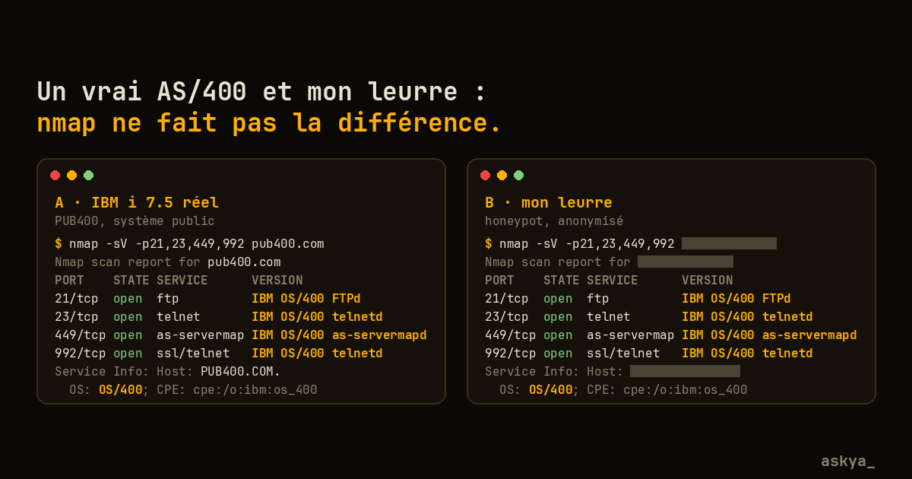
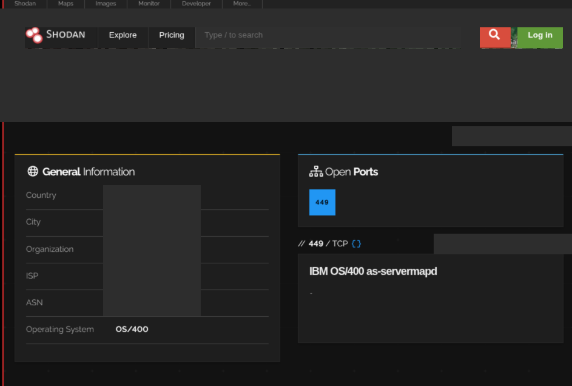

Dans [l'article de présentation](../ibm-i-as400/), on a vu que l'IBM i reste un angle mort du pentest. Pour savoir qui s'intéresse vraiment à ces machines sur Internet, j'ai monté un leurre qui se présente comme un IBM i 7.5. Avant de pouvoir observer quoi que ce soit, il fallait d'abord passer un test : **que les outils de reconnaissance ne fassent pas la différence entre le leurre et un vrai système**.

Cet article raconte la démarche et ce que j'en ai appris. Il ne donne volontairement pas la recette complète : je garde le code et le capteur privés, pour des raisons que j'explique à la fin.

## Comment nmap « voit » un OS/400

Contrairement à ce qu'on pourrait croire, la ligne `OS: OS/400` d'un `nmap -sV` ne vient pas d'une analyse de la pile réseau. Elle vient **des services**.

nmap envoie à chaque port ouvert une série de sondes (on se connecte et on attend, on envoie des lignes vides, une requête HTTP, un paquet Kerberos, une négociation SMB…) puis compare les réponses aux expressions régulières de son fichier public `nmap-service-probes`. Une signature IBM ressemble à ceci :

```
match telnet m|^\xff\xfd\x27\xff\xfd\x18$| p/IBM OS\/400 telnetd/ o/OS\/400/ cpe:/o:ibm:os_400/
```

Le champ `o/OS/400/` suffit à produire la ligne de synthèse `Service Info: OS: OS/400; CPE: cpe:/o:ibm:os_400`. Conclusion : **pour passer pour un IBM i face à `-sV`, il faut que chaque service réponde comme celui d'IBM**, aux bons octets et au bon moment.

## La méthode : mesurer, pas deviner

Toute la difficulté est de ne rien inventer. La boucle, appliquée à chaque port :

1. **Observer un système réel** auquel on a accès, et capturer ce qu'il répond aux mêmes sondes que nmap.
2. **Lire la signature** correspondante pour savoir ce qui est réellement comparé : souvent quelques octets seulement, parfois le moment où ils arrivent.
3. **Reproduire le comportement minimal**, en notant d'où vient chaque choix.
4. **Comparer côte à côte**, à la même minute et depuis la même machine, jusqu'à ne plus voir de différence.

> Ne codez rien à partir de ce que « devrait » faire un IBM i. Codez ce qu'il fait, et que vous avez mesuré.

Pour apprendre la plateforme, il existe un IBM i 7.5 public et gratuit tenu par la communauté, **PUB400**. C'est une ressource précieuse pour qui débute sur IBM i. C'est aussi un service gratuit, pensé pour l'apprentissage et pas comme terrain de scan : si vous l'utilisez comme référence, quelques connexions ponctuelles suffisent, pas de scan massif, pas de brute-force.

## Ce que j'ai appris en route

Je ne détaille pas chaque réponse, mais quelques constats méritent d'être partagés, parce qu'ils vont souvent à l'encontre de l'intuition.

**Le contenu ne suffit pas, le tempo compte.** Certaines signatures portent autant sur le *moment* où la réponse arrive que sur son contenu. Un IBM i a ses propres délais, que ce soit avant une bannière ou avant un refus de login. Un leurre qui a les bons octets mais le mauvais rythme se trahit.

**Un vrai système a des « défauts » qu'il faut reproduire.** Sur l'interface d'administration, la redirection d'un vrai IBM i contient une URL légèrement malformée. La « corriger » rendrait le leurre plus propre… et plus facile à distinguer du vrai.

**Des services différents peuvent répondre exactement pareil.** Sur un vrai 7.5, plusieurs *host servers* distincts renvoient la même réponse octet pour octet à certaines sondes de nmap : le serveur renvoie une trame d'erreur générique qui recopie une partie de la requête reçue, sans rien dire de son identité. L'intuition pousse à leur donner des réponses différentes. Ce serait justement une erreur.

**Une erreur bien formée vaut mieux qu'une réponse complète.** Face à une sonde incomplète, un vrai IBM i ne répond pas toujours par la réponse « attendue » du protocole, mais par une erreur de syntaxe au format exact. C'est cette erreur qu'il faut imiter, pas le protocole idéal.

**Les vrais clients vont plus loin que nmap.** Un scanner s'arrête à la première réponse. Un client 5250, FTP ou base de données pousse le dialogue beaucoup plus loin. Un leurre crédible face à un humain doit tenir au-delà de l'empreinte.

**Les détails d'apparence comptent aussi.** Un certificat TLS émis la veille du scan, ou une identité d'entreprise qui ne tient pas debout, se remarquent autant qu'un octet faux.

## Le résultat

Le même `nmap -sV`, lancé à la même minute et depuis la même machine, sur un vrai IBM i et sur le leurre :



nmap ne répond pas « service inconnu » : des deux côtés, il annonce un IBM OS/400, avec le même CPE. Sans les étiquettes, impossible de dire lequel est le vrai.

Deuxième juge, plus important encore : **Shodan**, le moteur que tout le monde utilise pour trouver des machines exposées. Ses sondes à lui sont passées d’elles-mêmes, et il a classé le leurre comme OS/400, avec un port 449 identifié `IBM OS/400 as-servermapd` :



C'est le seuil qui compte. Une fois que les outils de reconnaissance standards prennent le leurre pour un vrai IBM i, ceux qui cherchent spécifiquement ces systèmes le trouvent tout seuls.

## Trois erreurs évitées en mesurant

J'ai reçu une analyse de l'empreinte qui recommandait trois « corrections ». Toutes les trois auraient éloigné le leurre du vrai système :

1. **« Plusieurs ports renvoient la même réponse, c'est un signe évident de faux ».** Faux : le vrai système fait exactement pareil, pour la raison vue plus haut.
2. **« Ce service ne renvoie pas la réponse attendue du protocole ».** Le vrai non plus, face à la même sonde. La sortie de nmap est identique sur les deux machines.
3. **« Fermez ces ports vidéo qui n'ont rien à faire là ».** Le leurre ne les avait jamais ouverts. En scannant d'autres hôtes publics sans aucun rapport depuis la même connexion, ils apparaissaient aussi ouverts : c'était **un équipement du fournisseur d'accès** qui intercepte ces ports pour toutes les destinations. Le même équipement rend d'ailleurs la détection d'OS par la pile inexploitable depuis cette connexion, y compris sur un vrai IBM i.

Leçon : **comparez toujours avec une référence, depuis le même point**, et méfiez-vous de votre propre réseau avant d'accuser la cible.

## Ce qu'il faut en retenir côté défense

Si un leurre peut tromper `nmap -sV` et Shodan, alors **une empreinte de service n'est pas une preuve**. Quelques réflexes, que l'on soit en pentest, en inventaire d'actifs ou en réponse à incident :

- **Ne vous fiez pas à une seule source.** Une bannière, une ligne `Service Info` ou une fiche Shodan sont des indices, pas un inventaire. Croisez avec ce que vous savez réellement du parc.
- **Regardez le comportement, pas seulement l'étiquette.** Ce qu'un service fait quand on pousse le dialogue en dit plus que ce qu'il annonce.
- **Jugez l'ensemble, pas chaque port.** Chaque service peut être plausible et l'ensemble rester improbable pour une vraie configuration.
- **Méfiez-vous de votre propre réseau.** Proxy transparent, interception par le FAI, TTL incohérents : avant de conclure sur une cible, scannez une référence depuis le même point.

Retournée, la même liste sert à construire un leurre crédible. C'est tout l'intérêt de l'exercice : apprendre à tromper un outil, c'est apprendre ce qu'il ne vérifie pas.

## Pourquoi je ne publie pas la recette

Je pourrais donner ici chaque réponse, octet par octet, et le code qui va avec. Je ne le fais pas, pour deux raisons.

- **La recette complète est aussi une checklist de détection.** Publier exactement comment le leurre imite un IBM i, c'est publier comment le repérer, et dégrader les données qu'il collecte.
- **Un faux AS/400 clé en main n'est pas un outil anodin.** Un leurre convaincant peut servir à autre chose qu'à de la recherche.

Ce qui fait la valeur de ce travail, c'est la méthode et ce qu'elle apprend. C'est ce que je partage. Si un jour je publie le capteur lui-même, ce sera un choix assumé, à part, et pas un effet de bord d'un article de blog.

## La suite

L'empreinte tient. Dans le prochain article : ce qui arrive réellement sur un faux AS/400 dans ses premières heures en ligne, entre scanners de recensement multiprotocoles et premiers bots.

---

*Tests uniquement sur des systèmes dont vous avez la maîtrise ou une autorisation. Le système de référence a été interrogé à raison de quelques connexions ponctuelles, sans aucune charge.*
